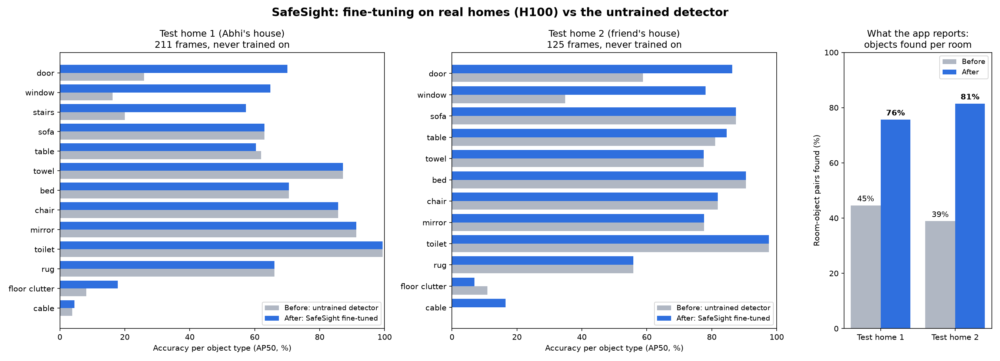

# SafeSight

Finds things in a home that may be risky or confusing for a person with dementia, based on the Alzheimer's Society guide *Making your home dementia friendly*. A caregiver films a room on their phone (or uploads photos); SafeSight shows each thing that may be a problem, a few seconds of their own video where it was seen, why it matters, what we measured, what the guide says, and a cheap fix.

Built at BananaHacks 2026.

## What it does

1. **Upload** photos or one video of a room, or film it live in the browser.
2. **Watch it work.** The loader shows each real step (picking clear frames, blurring people, finding objects, checking contrast, making clips), the frame being checked, how many things were found so far and about how long is left.
3. **Read the results.** One row per finding:
   - a 3-second clip from the caregiver's video with the object framed as it moves (or the best photo, spotlit);
   - why it may be a problem, in plain words ("may be a problem", never "is dangerous");
   - what we measured: the object's color next to its surroundings and their light reflectance, against the 20-point line the dementia design guides use;
   - what the guide says, with a link to the source;
   - a free first step, a priced fix and where to buy it, plus a printable fix plan.

Most hazards for people with dementia are about **contrast**: a white toilet against a white wall, a dark rug that looks like a hole, a door that blends into the wall. The detector finds the objects; the contrast checks decide what may be a problem.

## Results

Scored on two homes the model never trained on: Abhi's house (211 frames, 613 hand-checked boxes) and a friend's whole house (125 frames, 398 boxes).



| Objects found per room (what the app reports) | Untrained detector | SafeSight |
|---|---|---|
| Test home 1 | 45% | **76%** |
| Test home 2 | 39% | **81%** |
| Both | 42% | **78%** |

- Biggest gains: doors (26% → 70% and 59% → 86% per photo), windows (16% → 65%, 35% → 78%), stairs (20% → 57%).
- Floor clutter is found in 9 of 11 rooms that have it in home 1 (the untrained detector: 2). Cables remain hard: thin cords are found in 3 of 6 rooms in home 2 and 1 of 5 in home 1.
- Where the untrained detector was already better (toilets, mirrors, beds, chairs, towels, sofas, rugs), SafeSight keeps using it for those objects. Per-label choices were made on validation photos, except towel, sofa and door, where both test homes agreed; the room-level numbers above did not change with those three.
- Numbers come from `model/scripts/evaluate.py`, `room_eval.py` and `make_chart.py`; raw numbers in `model/results/accuracy.json`.

## How it works

- **Frames:** about one sharp, distinct frame per second of video (blurry and repeated frames dropped), at most 40 per video.
- **Privacy:** every person is blurred before any frame is written; the uploaded video is deleted when the check finishes; old results are pruned.
- **Objects:** our fine-tuned detector (16 object types: rug, toilet, toilet roll holder, towel, mirror, stairs, cable, floor clutter, bin, bed, sofa, chair, table, door, window, glass door). For each object type the app uses whichever trained run did best (`model/combo.json`).
- **Outlines and surfaces:** SAM 2.1 traces each object; Grounding DINO finds floor, walls, doors and windows.
- **Contrast checks** (`model/scripts/analyze.py`): light reflectance (LRV) of each object against what's around it; under 20 points is flagged and under 10 is serious, adjoining floors more than 10 apart may look like a step, plus checks for dark rugs, busy patterns, glare, glass doors, uncovered windows at night and stair edges. 16 hazard types in all, each sourced in `model/HAZARD_RESEARCH.md`.
- **Clips:** for each finding in a video, 3 seconds around the moment it was seen, people blurred, and a box track from the detector so the website can frame the object as it moves.

## The model

- **Starting point:** YOLO-World v2 L, an open-vocabulary detector, fine-tuned on an NVIDIA H100 (Brev) in 11 training runs; frozen backbone, 1024-px images.
- **Training data:** about 66,000 images from public datasets (below), plus real phone videos: 342 hand-checked frames from friends' homes and Anish's cable videos, 178 frames of Anish's home and 466 hand-reviewed frames from Charades homes, each repeated so real homes weigh more. 1,500 copy-paste images add towels, glass doors and cables onto real home photos.
- **Labeling:** models pre-label; every box is reviewed by eye and the real-home frames were checked by us in Label Studio (`model/scripts/charades_candidates.py`, `sync_friends.py`).
- **Picking the final model:** each run is scored per object type on validation photos; the app uses the best run for each (`model/scripts/combo.py`), checked across both test homes (`cross_select.py`).
- **Tried and not used:** pseudo-labeling (no gain), averaging weights ("model soup", worse on validation), and generative "after" pictures with SDXL inpainting (`model/scripts/fix_sdxl.py`), which often changed the room itself; the app's after pictures recolor only the flagged object.
- Plan, decisions and dataset counts: `model/PLAN.md`.

## Run it

Needs Python 3.11, ffmpeg and the GitHub CLI (`brew install python@3.11 ffmpeg gh && gh auth login`). The weights aren't in git: `setup.sh` installs the Python packages and downloads the fine-tuned detector from this repo's `model-v6` release, and Grounding DINO and SAM 2.1 from Hugging Face (about 2.5 GB in all, once).

```
# analysis service
model/scripts/setup.sh
cd model && DETECTOR=combo .venv/bin/uvicorn service:app --port 8000
# or, with a public link for a hosted website:
model/scripts/serve.sh

# website
cd app && echo "NEXT_PUBLIC_BRAIN_URL=http://localhost:8000" > .env.local && npm install && npm run dev
```

Without `NEXT_PUBLIC_BRAIN_URL` the website shows the bundled example results. The API is described in `shared/README.md`. `backend/` is an earlier prototype of the service using the untrained detector.

Measured on an Apple-silicon Mac: 5 photos in about 12 s, a 25-second video in about 75 s, a 2-minute house tour in about 90 s.

## Credits

### Guide and research

- Hazards, wording and fixes follow the Alzheimer's Society guide [*Making your home dementia friendly*](https://www.alzheimers.org.uk/sites/default/files/migrate/downloads/making_your_home_dementia_friendly.pdf).
- Contrast rules and further hazards from the Alzheimer's Society factsheet *Changes in perception*, the University of Stirling Dementia Services Development Centre (housing design guide and light reflectance values), the King's Fund *Is your housing dementia friendly?*, the NHS, the National Institute on Aging, the Alzheimer's Association, Dementia UK, the Thomas Pocklington Trust lighting guide and the CDC STEADI *Check for Safety* brochure. Links in `model/HAZARD_RESEARCH.md`.

### Models

- [YOLO-World v2 L](https://docs.ultralytics.com/models/yolo-world/) (`yolov8l-worldv2`, Ultralytics, AGPL-3.0): the detector we fine-tuned, and used untrained for some object types. Its text prompts use OpenAI's [CLIP](https://github.com/openai/CLIP) (MIT), from [Ultralytics' fork](https://github.com/ultralytics/CLIP).
- [Grounding DINO](https://github.com/IDEA-Research/GroundingDINO) base (IDEA Research, Apache-2.0, via Hugging Face Transformers): floor, wall, door and window regions, the untrained baseline, and pre-labeling training data.
- [SAM 2.1](https://github.com/facebookresearch/sam2) hiera-large (Meta, Apache-2.0, via Hugging Face Transformers): object outlines for the contrast checks.
- [YOLO11](https://docs.ultralytics.com/models/yolo11/) (`yolo11m`, Ultralytics, AGPL-3.0, trained on COCO): finds people so they can be blurred.
- Tried and not used: [Stable Diffusion XL inpainting 0.1](https://huggingface.co/diffusers/stable-diffusion-xl-1.0-inpainting-0.1) (CreativeML Open RAIL++-M) for after pictures.
- The earlier prototype in `backend/` used YOLO-World v2 S, YOLO11 segmentation (`yolo11n-seg`) and SAM 2.1 tiny through Ultralytics.

### Datasets

- [Open Images V7](https://storage.googleapis.com/openimages/web/index.html) (Google; annotations CC BY 4.0, images CC BY 2.0).
- [ADE20K](https://groups.csail.mit.edu/vision/datasets/ADE20K/) (MIT CSAIL; scene parsing benchmark and the full dataset via [Hugging Face](https://huggingface.co/datasets/1aurent/ADE20K)), research use.
- [LVIS v1](https://www.lvisdataset.org) (CC BY 4.0) on [COCO](https://cocodataset.org) images.
- [Objects365](https://www.objects365.org) (non-commercial research license), via the [hieupth/objects365_384_squared](https://huggingface.co/datasets/hieupth/objects365_384_squared) mirror.
- [Trans10K-v2](https://github.com/xieenze/Trans2Seg) (glass objects), via [rdyzakya/Trans10K-v2](https://huggingface.co/datasets/rdyzakya/Trans10K-v2).
- [SUN RGB-D](https://rgbd.cs.princeton.edu) (Song, Lichtenberg and Xiao, CVPR 2015), research use.
- [ADL: Activities of Daily Living](https://web.cs.ucdavis.edu/~hpirsiav/papers/ADLdataset/) (Pirsiavash and Ramanan, CVPR 2012), research use.
- [Charades](https://prior.allenai.org/projects/charades) (Sigurdsson et al., Allen Institute for AI, 2016), non-commercial research license.
- robot6000, floor-level photos from robot vacuums ([MORAN-ASLDK/Pubilc-datasets](https://github.com/MORAN-ASLDK/Pubilc-datasets)).
- 18 [Roboflow Universe](https://universe.roboflow.com) datasets, all CC BY 4.0: stairs (bcpmodel1commona/stairs-spqnr, tom-lai-8bp7n/stairs-i2yia, kaist-9sscg/stairs-segmentation), cables (bartu-erguven-qpopt/cable-dataset, superfish-5k9sp/robot-vacuum-cleaner), clutter (hoarding-support/clutter-classes, sasya-0ullp/messy-room-y5qsc, sds-first-workspace/messy-imgs), bathrooms (sapiens/toilet-seat-object-detection, svalab12/bathroom-lyfer, adrian-gorcea/bathroom-sdsne, practicas-preprofesionales/toilet-paper-rv8hr), rugs (asdasd-fl13n/carpet-segmentation, ai-dataset-8dqwo/carpet-rjju3, ethan-tigrik-zgtmb/carpet-calpo) and glass doors (annotation-4rrq6/shower-and-screen-91lzq, indoor-detection/glass-door-stair-fish_tank-tllvf, xinen-2awjn/hazardcap-glass-door). Versions in `model/data/roboflow/sources.json` (not in git) and `model/PLAN.md`.
- Our own and friends' home videos, shared with permission. They are used for training and testing only, people are blurred, and none of them are in this repo.

### Libraries and tools

- App: [Next.js](https://nextjs.org), [React](https://react.dev), [Tailwind CSS](https://tailwindcss.com), [Motion](https://motion.dev), [clsx](https://github.com/lukeed/clsx), [tailwind-merge](https://github.com/dcastil/tailwind-merge), [TypeScript](https://www.typescriptlang.org), [Vitest](https://vitest.dev) and [ESLint](https://eslint.org).
- Service and model: [PyTorch](https://pytorch.org), [Ultralytics](https://github.com/ultralytics/ultralytics), [Hugging Face Transformers](https://github.com/huggingface/transformers), [huggingface_hub](https://github.com/huggingface/huggingface_hub), [Diffusers](https://github.com/huggingface/diffusers) (SDXL test), [FastAPI](https://fastapi.tiangolo.com), [Uvicorn](https://www.uvicorn.org), [OpenCV](https://opencv.org), [NumPy](https://numpy.org), [pandas](https://pandas.pydata.org), [SciPy](https://scipy.org), [Matplotlib](https://matplotlib.org), [Pillow](https://python-pillow.org), [pillow-heif](https://github.com/bigcat88/pillow_heif) (iPhone photos), [ImageHash](https://github.com/JohannesBuchner/imagehash), [remotezip](https://github.com/gtsystem/python-remotezip), [python-multipart](https://github.com/Kludex/python-multipart), [FFmpeg](https://ffmpeg.org), [pytest](https://pytest.org) and [HTTPX](https://www.python-httpx.org).
- [Label Studio](https://labelstud.io) for checking labels, [Cloudflare Tunnel](https://www.cloudflare.com/products/tunnel/) for the public link, and [NVIDIA Brev](https://developer.nvidia.com/brev) for the H100.
- [Fancy Components](https://www.fancycomponents.dev) by Daniel Petho (MIT): Vertical Cut Reveal and Text Rotate, via [21st.dev](https://21st.dev). The text highlight in `app/src/components/ui/text-highlight.tsx` is modeled on its Text Highlighter.
- [Magic UI](https://magicui.design) (MIT): the scroll fade in `app/src/components/ui/blur-fade.tsx` is modeled on its Blur Fade.
- The site's look takes cues from [Gradient Labs](https://gradient-labs.ai).

### Fonts

- [Geist](https://vercel.com/font) (Vercel) and [Inter](https://rsms.me/inter/) (Rasmus Andersson), both SIL Open Font License, through Google Fonts. The earlier designs kept at `/v1` to `/v4` also use Manrope, Atkinson Hyperlegible, Newsreader and IBM Plex Mono (all SIL Open Font License); Newsreader also sets the small section labels on the results page.

### Images

- Website photos are from [Unsplash](https://unsplash.com) (Unsplash License), loaded from Unsplash and never stored in this repo: Clay Banks, Point3D Commercial Imaging Ltd., Lisa Anna, Alex Tyson, Abdul Kayum, David Marquez, avechenri, Brina Blum, Franco Debartolo, CDC, Jakub Żerdzicki and Centre for Ageing Better. Links to each photo are in `backend/tools/stock_photos.py`. The hazards and outlines drawn on them are our pipeline's real output (`backend/tools/annotate_site_images.py`); the findings shown were checked by us, since the starting model also makes mistakes.
- The example living room on the home page (`app/public/site/room-wide.jpg`) is AI-generated with OpenAI's GPT-6 Astra, from a prompt we wrote; the findings on it are our pipeline's real output, checked by us.
- Store logos in the "Where to buy" section (`app/public/site/stores/`) are from [Wikimedia Commons](https://commons.wikimedia.org) and shown in black and white. They are trademarks of their owners; SafeSight isn't affiliated with any of these stores. All are public domain on Commons except the Menards logo, [Menards Stripe Logo.svg](https://commons.wikimedia.org/wiki/File:Menards_Stripe_Logo.svg) by Mrpeters33, [CC BY-SA 4.0](https://creativecommons.org/licenses/by-sa/4.0) (shown in black and white). Sources: [Walmart](https://commons.wikimedia.org/wiki/File:Walmart_logo_(2025).svg), [Target](https://commons.wikimedia.org/wiki/File:Target_logo.svg), [Amazon](https://commons.wikimedia.org/wiki/File:Amazon_logo.svg), [The Home Depot](https://commons.wikimedia.org/wiki/File:The_Home_Depot_logo.svg), [Lowe's](https://commons.wikimedia.org/wiki/File:Lowes_Companies_Logo.svg), [IKEA](https://commons.wikimedia.org/wiki/File:Ikea_logo.svg), [Wayfair](https://commons.wikimedia.org/wiki/File:Wayfair_logo.svg), [Costco](https://commons.wikimedia.org/wiki/File:Costco_Wholesale_logo_2010-10-26.svg), [Ace Hardware](https://commons.wikimedia.org/wiki/File:Ace_Hardware_Logo.svg), [Kohl's](https://commons.wikimedia.org/wiki/File:Kohl%27s_logo.svg), [Dollar General](https://commons.wikimedia.org/wiki/File:Dollar_General_logo.svg).
- An earlier version of the site used images generated with [Stable Diffusion XL 1.0](https://huggingface.co/stabilityai/stable-diffusion-xl-base-1.0) (`backend/tools/generate_site_images.py`).

### AI tools

- [Claude Code](https://claude.com/claude-code) (Anthropic) with Claude Opus 5.5 helped write the app, service and model code, tests and site wording, researched design references and dementia guidance, ran and checked the training runs, and pre-labeled and reviewed training frames (which we then checked in Label Studio); commits it helped with say so. Some of Abhi's commits were written with Claude Fable 5.1.
- OpenAI's GPT-6 Astra generated the example living room (above).
